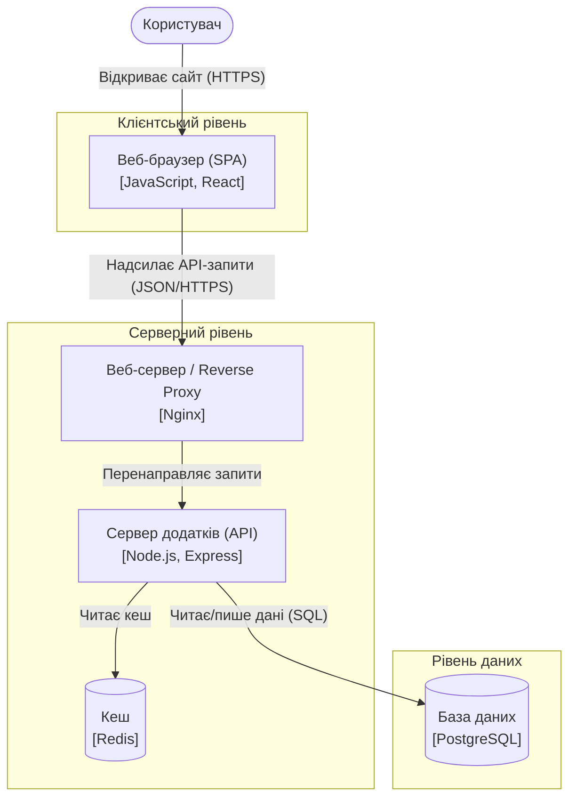

# Практична робота 12. Проєктування архітектури програмної системи

**Проєкт:** Вебзастосунок «CourseHub» — система онлайн-запису на курси
**Виконав:** Осіпович Ярослав

---

## 1. Ключові вимоги до архітектури (NFR)

Для вибору архітектури було обрано 5 найважливіших вимог з Практичної роботи 5:

1. **NFR-01 (Продуктивність):** Час завантаження каталогу ≤ 1.5 сек. *Вплив:* вимагає впровадження шару кешування (Redis) та оптимізації запитів до БД.
2. **NFR-03 (Безпека):** Хешування паролів (bcrypt) та захист даних. *Вплив:* вимагає виділеного шару автентифікації та авторизації, захищеного з'єднання (HTTPS).
3. **NFR-06 (Надійність):** Доступність 99.5%. *Вплив:* вимагає налаштування балансувальника навантаження та можливості горизонтального масштабування серверів додатків.
4. **NFR-07 (Супровідність):** Покриття тестами ≥ 70%. *Вплив:* вимагає чіткого розділення коду на незалежні модулі (шари) для легкої ізоляції під час тестування.
5. **FR-09 (Бізнес-логіка):** Блокування запису при ліміті місць. *Вплив:* вимагає використання транзакцій у базі даних для уникнення стану гонки (race condition), коли двоє користувачів одночасно займають останнє місце.

---

## 2. Оцінювання варіантів архітектури

Оцінювання проводиться за 5-бальною шкалою (5 — найкраще, 1 — найгірше).

| Критерій | Вага, % | Модульний моноліт | Клієнт–сервер (3-рівнева) | Мікросервіси |
| :--- | :--- | :--- | :--- | :--- |
| Складність розроблення | 20 | 5 | 4 | 2 |
| Складність супроводу | 15 | 4 | 4 | 2 |
| Масштабованість | 20 | 3 | 4 | 5 |
| Безпека | 15 | 4 | 4 | 3 |
| Строк реалізації | 20 | 5 | 4 | 2 |
| Вартість | 10 | 5 | 4 | 2 |
| **Зважена оцінка** | **100** | **4.35** | **4.0** | **2.75** |

*(Розрахунок зваженої оцінки для 3-рівневої: (4\*0.2)+(4\*0.15)+(4\*0.2)+(4\*0.15)+(4\*0.2)+(4\*0.1) = 4.0)*

---

## 3. Обґрунтування вибору та ризики

**Обрана архітектура:** 3-рівнева клієнт-серверна (з виділенням шарів всередині серверної частини).

**Обґрунтування:**
1. Це оптимальний баланс між швидкістю розробки та масштабованістю для MVP проєкту.
2. Чіткий поділ на рівні (клієнт, сервер додатків, база даних) дозволяє незалежно змінювати інтерфейс (наприклад, додати мобільний застосунок у майбутньому), не змінюючи бізнес-логіку.
3. На відміну від мікросервісів, ця архітектура не вимагає складного DevOps-налаштування, що критично важливо для обмеженого часу на реалізацію.
4. Вона легко витримує навантаження на етапі запуску.

**Ризики:**
* Перевантаження єдиного сервера додатків при різкому зростанні користувачів (нівелюється налаштуванням горизонтального масштабування).
* Затримки мережі між сервером та БД (нівелюється кешуванням).

---

## 4. Діаграма архітектури (C4 Level 2 - Containers)

---

## 5. Запис архітектурного рішення (ADR-001)

* **Статус:** Запропоновано.
* **Дата:** 27.11.2026.
* **Контекст:** Нам потрібно розробити систему для запису на курси. Система повинна бути швидкою (NFR-01), безпечною (NFR-03) та мати розумні терміни розробки.
* **Рішення:** Використати 3-рівневу клієнт-серверну архітектуру (Frontend SPA + Backend API + Database).
* **Розглянуті альтернативи:**
  * *Модульний моноліт:* Відкинуто, оскільки важче масштабувати окремі частини системи.
  * *Мікросервіси:* Відкинуто через надмірну складність та високу вартість для проєкту такого масштабу.
* **Наслідки:**
  * *Позитивні:* Швидка розробка, зрозуміла структура, можливість незалежного оновлення клієнта та сервера.
  * *Негативні:* Потреба у кваліфікованому налаштуванні зв'язку між клієнтом та сервером (CORS, авторизація токенів).

---

## 6. Індивідуальне завдання: Сценарій відмови

**Сценарій:** Різке зростання навантаження у 10 разів (наприклад, під час відкриття запису на популярний безкоштовний курс).

**Як реагує архітектура:** 
При поточній конфігурації веб-сервер Nginx може не впоратися з напливом запитів, а сервер додатків (Node.js) вичерпає оперативну пам'ять, що призведе до відмови в обслуговуванні (HTTP 502 Bad Gateway). База даних також може заблокуватися через велику кількість одночасних транзакцій запису.

**2 тактики покращення:**
1. **Горизонтальне масштабування (Scaling Out):** Налаштувати Nginx як балансувальник навантаження (Load Balancer) та запустити 3-4 копії (екземпляри) сервера додатків. Це дозволить розподілити трафік.
2. **Черги повідомлень (Message Queue) та кешування:** Використовувати Redis для віддачі каталогу курсів (щоб узагалі не турбувати БД). Для записів на курс використати чергу (наприклад, RabbitMQ), щоб обробляти запити на запис послідовно (один за одним), запобігаючи блокуванню бази даних.

---

## 7. Відповіді на контрольні запитання

1. **Що таке архітектура програмної системи?**
   Це сукупність структурних елементів системи (компонентів, модулів, шарів), їхніх властивостей та зв'язків між ними, а також принципів, які керують їхнім проєктуванням та еволюцією.
2. **Як нефункціональні вимоги впливають на вибір архітектури?**
   Вони визначають "якість" системи. Наприклад, вимога високої масштабованості штовхає до мікросервісів або хмарних рішень, вимога безпеки — до виділення окремого шару автентифікації, а вимога продуктивності — до використання кешу.
3. **Порівняйте моноліт і мікросервіси.**
   *Моноліт* — це єдина кодова база та процес розгортання. Він простіший і дешевший на старті, але складніший у масштабуванні окремих частин. *Мікросервіси* — це набір незалежних невеликих сервісів. Вони складніші у розробці та супроводі, але забезпечують найкращу гнучкість та масштабованість для великих систем.
4. **Що таке ADR і з чого він складається?**
   ADR (Architecture Decision Record) — це документ, що фіксує важливе архітектурне рішення. Складається з: контексту (проблеми), прийнятого рішення, розглянутих альтернатив, статусу (прийнято/відхилено) та наслідків (позитивних і негативних).
