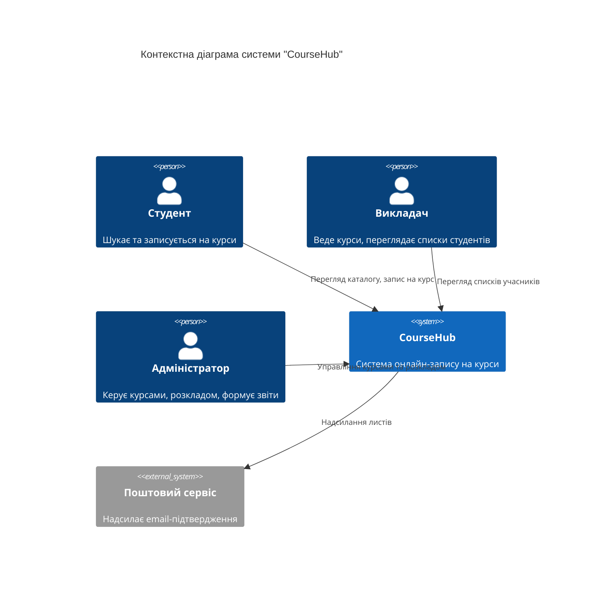
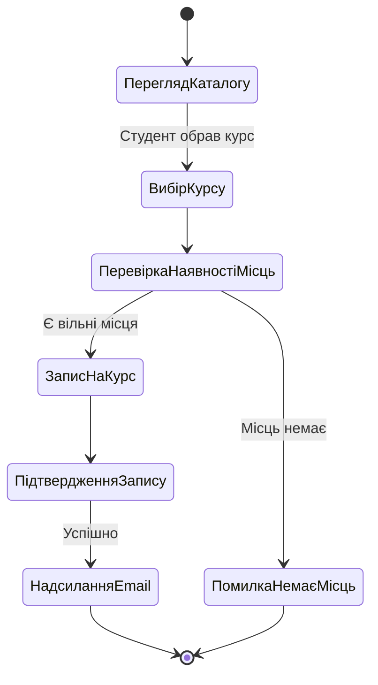

# Практична робота 7. Побудова моделі програмної системи засобами UML

**Проєкт:** Вебзастосунок «CourseHub» — система онлайн-запису на курси
**Виконав:** студент Осіпович Ярослав

---

## 1. Карта моделей проєкту

| Запитання | Модель | Інструмент | Практична робота |
| :--- | :--- | :--- | :--- |
| Хто користується системою й для чого? | діаграма Use Case | draw.io | 9 |
| Які об'єкти існують і як зв'язані? | діаграма класів | draw.io | 10 |
| Як виконується ключовий сценарій? | діаграма послідовності | Mermaid | 11 |
| Як система розділена на частини? | діаграми компонентів, розгортання | draw.io | 12, 17 |
| Які дані зберігаються? | ER-діаграма | draw.io | 18 |

---

## 2. Налаштування інструменту
У репозиторії створено каталог `docs/diagrams/`. Прийнято такі правила іменування файлів:
- Діаграми, створені в draw.io: `назва-діаграми.drawio` (наприклад, `usecase-main.drawio`).
- Текстові діаграми (Mermaid/PlantUML): `назва-діаграми.md` або `.puml` (наприклад, `context-c4.md`).

---

## 3. Контекстна діаграма системи (C4 Context)

Нижче наведено вихідний код контекстної діаграми (Mermaid). GitHub автоматично відобразить її як графічну схему.

---

## 4. Кандидати в класи та операції (Аналіз тексту)

На основі тексту вимог (Практична 5 та 6) було виділено іменники та дієслова.

| Кандидат | Тип (Іменник/Дієслово) | Обґрунтування | Рішення |
| :--- | :--- | :--- | :--- |
| Студент | Іменник | Роль користувача, що взаємодіє з системою | **Залишити** (Клас `Student`) |
| Курс | Іменник | Основний предметний об'єкт системи | **Залишити** (Клас `Course`) |
| Запис | Іменник | Фіксує факт реєстрації студента на курс | **Залишити** (Клас `Enrollment`) |
| Викладач | Іменник | Роль користувача, що веде курс | **Залишити** (Клас `Teacher`) |
| Розклад | Іменник | Об'єкт, що містить дати та час занять | **Залишити** (Клас `Schedule`) |
| Записатися | Дієслово | Операція взаємодії студента з курсом | **Залишити** (Метод `enroll()`) |
| Скасувати | Дієслово | Операція видалення запису | **Залишити** (Метод `cancel()`) |
| Швидко | Прислівник | Не є об'єктом (це вимога NFR) | Відкинути |
| Звіт | Іменник | Результат діяльності адміністратора | Відкинути (це функція, а не доменний об'єкт) |

---

## 5. Перевірка узгодженості
Актори на контекстній діаграмі (Студент, Викладач, Адміністратор) повністю відповідають списку зацікавлених сторін, визначеному в картці проєкту (Практична 4). Зовнішньою системою виступає лише поштовий сервіс, оскільки інтеграція з платіжними системами на етапі MVP не передбачена.

---

## 6. Індивідуальне завдання: Діаграма діяльності (TO-BE)

Діаграма діяльності для головного процесу «Запис студента на курс» із розгалуженням та умовами завершення.

---

## 7. Відповіді на контрольні запитання

1. **Що таке модель і навіщо моделюють програмні системи?**
   Модель — це спрощене уявлення реальної системи, яке відображає лише суттєві для конкретної задачі аспекти. Моделювання дозволяє зрозуміти структуру системи, виявити помилки на ранніх етапах, спростити комунікацію між розробниками та замовниками, а також слугує документацією.
2. **Які рівні має модель С4?**
   Модель C4 складається з 4 рівнів абстракції:
   * Context (Контекст) — система та її взаємодія із зовнішнім світом (користувачами та іншими системами).
   * Containers (Контейнери) — архітектура на рівні застосунків, баз даних, мікросервісів.
   * Components (Компоненти) — логічні модулі всередині контейнерів.
   * Code (Код) — класи та інтерфейси (зазвичай генерується автоматично).
3. **Для чого складають карту моделей?**
   Карта моделей допомагає спланувати, які саме діаграми потрібно створити для проєкту, якими інструментами їх будувати і на якому етапі це робити. Вона запобігає хаосу в документації.
4. **Як за вимогами знайти кандидатів у класи?**
   Потрібно провести лексичний аналіз тексту вимог: виділити всі іменники (вони вказують на об'єкти/сутності, які стануть класами) та дієслова (вони вказують на дії/поведінку, які стануть методами/операціями). Потім відфільтрувати зайві слова (синоніми, абстрактні поняття).
