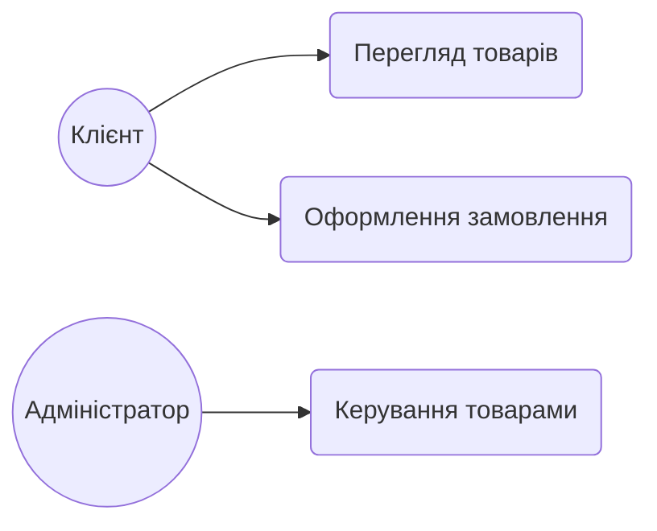
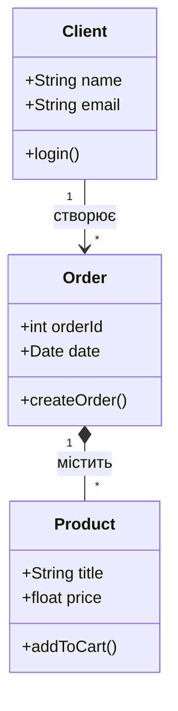
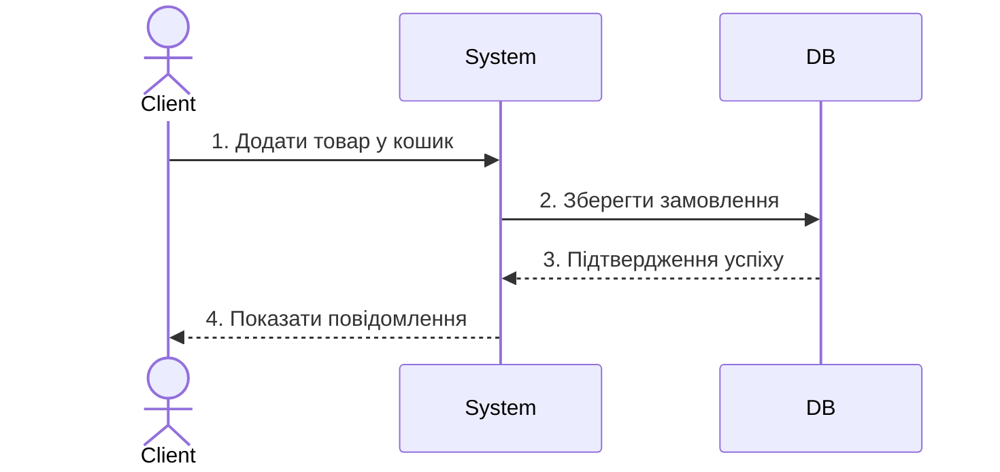
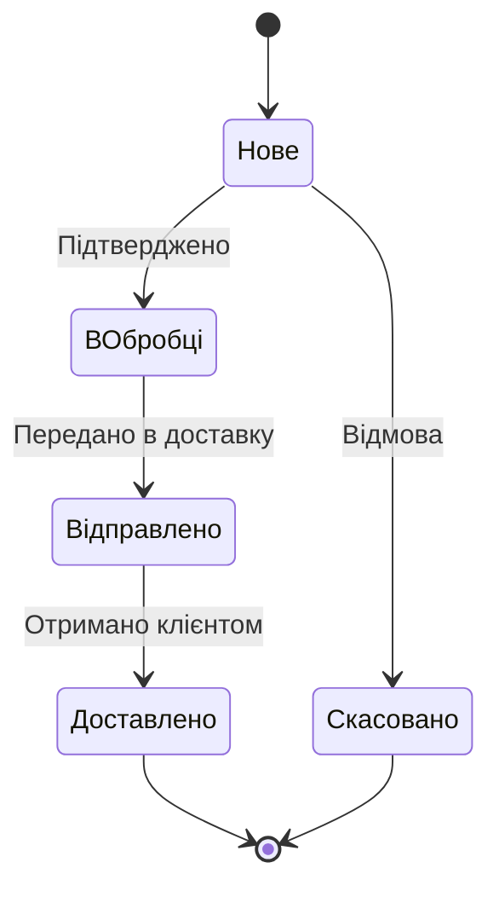
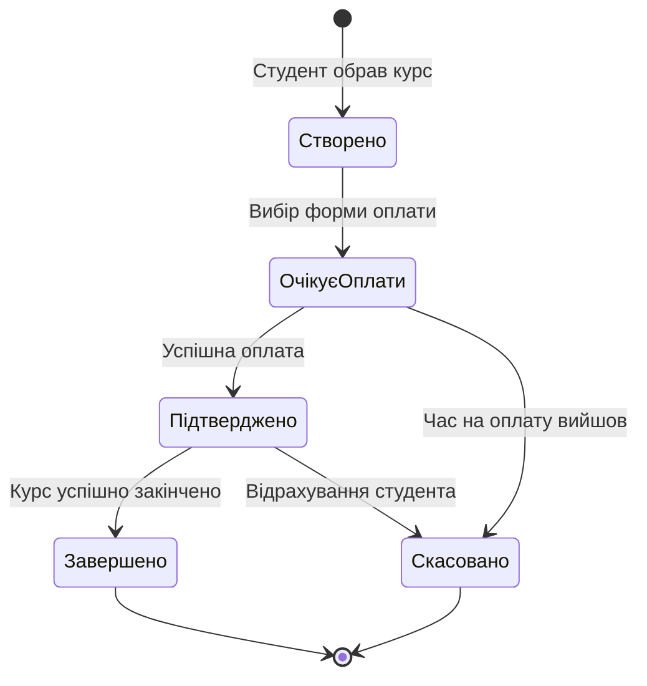
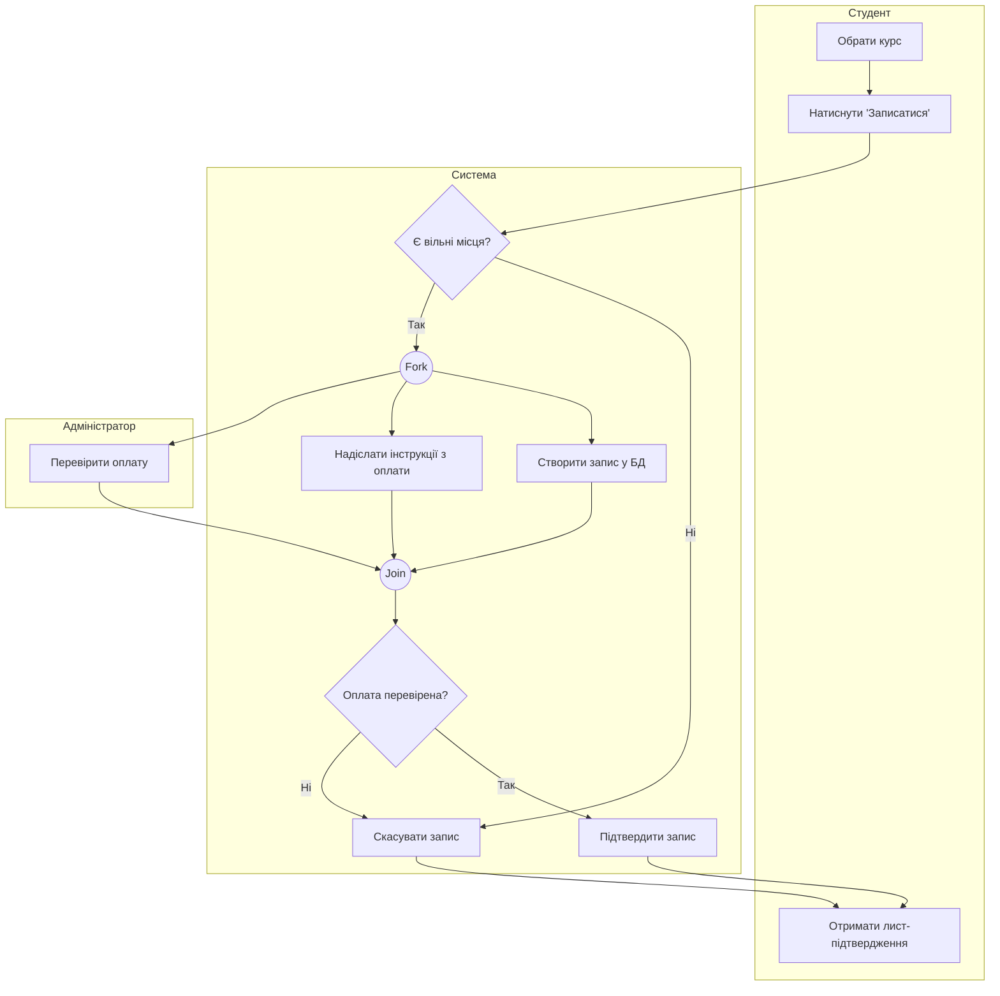

# Практична робота 8. Побудова моделі програмної системи засобами UML

**Проєкт:** Вебзастосунок «CourseHub» — система онлайн-запису на курси
**Виконав:** Осіпович Ярослав
**Версія:** 1.0

---
### Легенда нотації (Шаблон)
* **Актори:** позначаються фігурками (у Mermaid — овалами/текстом з дужками).
* **Прецеденти (Use Cases):** овали з дієслівними назвами.
* **Класи:** прямокутники з трьома секціями (назва, атрибути, методи).
* **Стани:** прямокутники із заокругленими кутами.
* **Стрілки:** показують напрямок зв'язку, потоку подій або залежності.

---

## Частина 1. Тренувальне завдання на прикладі «Інтернет-магазин»

### 1.1. Діаграма варіантів використання (Use Case)
*Актори: Клієнт, Адміністратор. Варіанти: Перегляд товарів, Оформлення замовлення, Керування товарами.*

### 1.2. Діаграма класів
*3 класи (Клієнт, Замовлення, Товар) із атрибутами, методами та зв'язками з кратністю.*

### 1.3. Діаграма послідовності
*3 учасники (Клієнт, Система, База Даних), 4 повідомлення.*

### 1.4. Діаграма станів замовлення
*4-5 станів для замовлення.*

---

## Частина 2. Діаграма станів ключової сутності проєкту

Ключова сутність проєкту «CourseHub» — **Запис на курс**.

---

## Частина 3. Діаграма діяльності складного процесу

Процес: **Запис студента на курс та підтвердження оплати**.
*Використано доріжки (swimlanes) для ролей: Студент, Система, Адміністратор. Додано розгалуження та паралельність (fork/join).*

---

## Частина 4. Чек-лист перевірки нотації

| Критерій | Статус | Примітка |
| :--- | :--- | :--- |
| Імена акторів, класів, станів зрозумілі | ✅ | Використано українську мову |
| Напрямок стрілок логічний | ✅ | Потоки даних ідуть від дії до дії |
| Кратність зв'язків вказана | ✅ | Використано `1`, `*`, `1..*` (у класах) |
| Стереотипи/видимість вказані | ✅ | Додано `+` для публічних методів |
| Відсутні «зайві» зв'язки | ✅ | Моделі мінімалістичні |

---

## Контрольні запитання

1. **Для чого призначені діаграми станів і діяльності?**
   * **Діаграма станів** описує життєвий цикл конкретного об'єкта (наприклад, як змінюється статус замовлення від створення до доставки) та умови переходів між станами.
   * **Діаграма діяльності** описує бізнес-процеси або алгоритми (потік робіт), показуючи послідовність дій, розгалуження (умови) та паралельні процеси.
2. **Які символи видимості застосовують у класах?**
   * `+` (public) — доступний з будь-якого місця.
   * `-` (private) — доступний лише всередині цього класу.
   * `#` (protected) — доступний всередині класу та його нащадків.
   * `~` (package) — доступний у межах пакета.
3. **Що таке кратність зв'язку? Наведіть приклади.**
   Кратність показує, скільки об'єктів одного класу пов'язано з одним об'єктом іншого класу. Наприклад: `1` до `1` (один студент має одну медичну картку), `1` до `*` (один клієнт робить багато замовлень), `1..*` (курс має від 1 до нескінченності студентів).
4. **Як вибрати діаграму для конкретної задачі?**
   Потрібно відштовхуватися від мети: якщо треба показати структуру (з чого складається) — обираємо *класи* або *компоненти*; якщо взаємодію з користувачем — *Use Case*; якщо послідовність дій у часі — *послідовності*; якщо логіку змін станів — *станів*; якщо складний бізнес-процес — *діяльності*.
