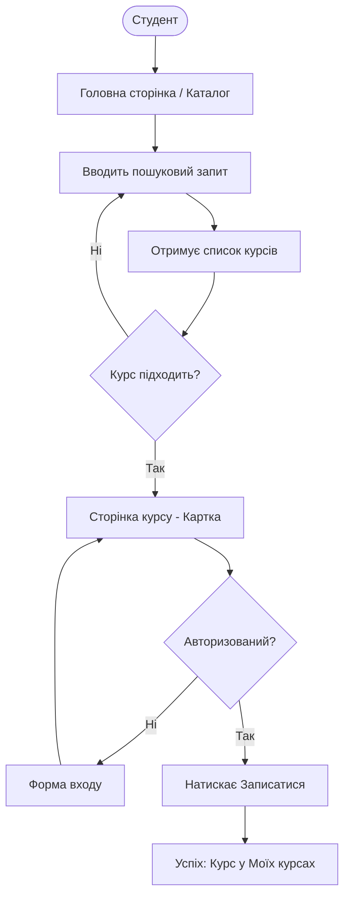
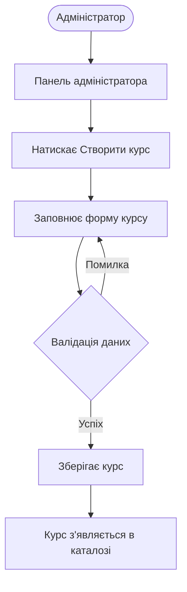
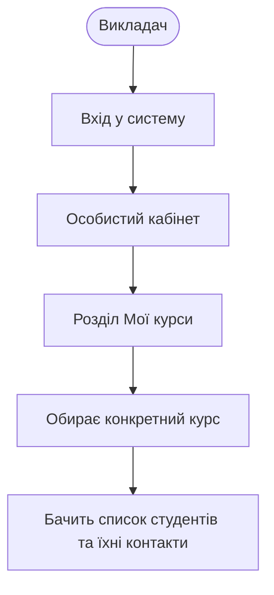
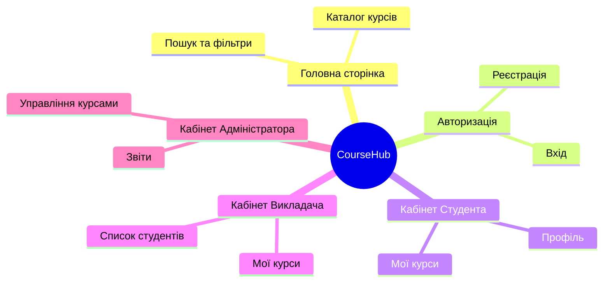

# Практична робота 15. Сценарії користувача, схема переходів і каркаси інтерфейсу

**Проєкт:** Вебзастосунок «CourseHub» — система онлайн-запису на курси
**Виконав:**Осіпович Ярослав

---

## 1. User Flow (Сценарії користувача)

### 1.1. Сценарій 1: Студент записується на курс

### 1.2. Сценарій 2: Адміністратор створює новий курс

### 1.3. Сценарій 3: Викладач переглядає студентів

---

## 2. Карта сторінок (Sitemap) та навігація

**Навігація:**
* Головне меню знаходиться у верхній частині екрана (Header).
* Максимальна кількість кроків до виконання типової задачі (наприклад, запис на курс): **3 кроки** (Каталог -> Картка курсу -> Кнопка «Записатися»).

---

## 3. Wireframes (Каркаси 5 екранів)

*Оскільки Markdown не підтримує графічні каркаси, нижче наведено їхній структурний опис (ви можете перенести це у Figma/draw.io для візуалізації).*

### 3.1. Екран 1: Головна сторінка (Каталог)
*   **Header:** Логотип `CourseHub` | Меню (Каталог, Мої курси) | Кнопка `Увійти`.
*   **Hero-блок:** Заголовок «Знайди свій ідеальний курс» + Великий рядок пошуку.
*   **Body:** Сітка з 6 карток курсів (Назва, Викладач, Ціна, Кнопка «Детальніше»).
*   **Sidebar (ліворуч):** Фільтри (Категорія, Рівень складності, Ціна).

### 3.2. Екран 2: Картка курсу
*   **Header:** Той самий.
*   **Main:** Велика назва курсу, Ім'я викладача, Тривалість.
*   **Content:** Опис курсу (абзаци), Програма курсу (список тем).
*   **Sidebar (праворуч):** Блок із ціною, Кількість вільних місць, Велика кнопка `Записатися на курс`.

### 3.3. Екран 3: Форма входу/реєстрації
*   **Центральний блок:** Заголовок «Вхід».
*   **Поля:** Email (input), Пароль (input з іконкою "око").
*   **Кнопки:** `Увійти` (основна), `Зареєструватися` (текстове посилання).

### 3.4. Екран 4: Особистий кабінет студента
*   **Header:** Той самий + Аватарка користувача.
*   **Tabs:** Мої курси | Історія | Налаштування.
*   **Body:** Список карток курсів, на які студент записаний (з прогрес-баром або статусом).

### 3.5. Екран 5: Панель адміністратора
*   **Sidebar:** Навігація (Курси, Студенти, Звіти).
*   **Main:** Таблиця з курсами (Назва, Викладач, Кількість записаних).
*   **Action:** Кнопка `+ Створити новий курс` над таблицею.

---

## 4. Перевірка за евристиками Нільсена

| Евристика | Як враховано в інтерфейсі | Що можна покращити |
| :--- | :--- | :--- |
| **1. Видимість стану системи** | Кнопка «Записатися» змінює колір на зелений і текст на «Ви записані». | Додати індикатор завантаження (спінер) під час відправки форми. |
| **2. Відповідність системи реальному світу** | Використання звичних термінів («Кошик», «Мої курси», «Викладач»). | Зробити іконки більш зрозумілими (наприклад, іконка книги для каталогу). |
| **3. Свобода дій користувача** | На будь-якій сторінці є кнопка «Назад» або «Скасувати». | Додати можливість скасувати запис на курс прямо з кабінету (кнопка «Скасувати»). |
| **4. Консистентність та стандарти** | Всі кнопки одного типу мають однаковий колір (синій) та розмір. | Уніфікувати відступи (padding) між блоками на всіх сторінках. |
| **5. Запобігання помилкам** | Поля форми підсвічуються червоним, якщо введено некоректний email. | Додати підказки (tooltips) до складних полів введення. |
| **6. Розпізнавання замість пригадування** | Усі фільтри (категорії) видно на екрані, не треба тримати їх у голові. | Зробити так, щоб обрані фільтри не зникали після оновлення сторінки. |

---

## 5. Перевірка доступності

*   **Розмір елементів керування:** Мінімальний розмір клікабельних елементів (кнопок) встановлено на рівні 44x44 px (для зручності натискання пальцем на мобільних).
*   **Послідовність фокусу:** При натисканні клавіші `Tab` фокус рухається логічно: Header -> Пошук -> Фільтри -> Картки курсів -> Кнопка "Записатися".
*   **Підписи полів:** Кожне поле форми має `<label>`, а не лише placeholder (щоб підпис не зникав при введенні тексту).
*   **Знайдені недоліки:** У початковому макеті контраст між сірим текстом placeholder та білим фоном був замалий. *Виправлено:* змінено колір тексту на темніший.

---

## 6. Індивідуальне завдання: Адаптивний варіант (Mobile)

**Обрані екрани:** Головна сторінка (Каталог) та Картка курсу.

**Що змінюється порівняно з ПК-версією:**
1.  **Меню (Header):** Замість горизонтального меню з'являється іконка «Гамбургер» (☰), яка відкриває випадаюче меню на весь екран.
2.  **Сітка курсів:** Замість 3-4 курсів в один ряд, на смартфоні курси відображаються в один стовпчик (1 картка на ширину екрану).
3.  **Фільтри:** На ПК вони збоку (Sidebar). На мобільному вони ховаються за кнопкою «Фільтри», яка відкриває модальне вікно (спливаюче вікно знизу).
4.  **Кнопка "Записатися":** На мобільному вона стає «липкою» (sticky) і завжди знаходиться внизу екрана, щоб користувачу не треба було гортати сторінку вгору.

---

## 7. Відповіді на контрольні запитання

1. **Чим UI відрізняється від UX?**
   *   **UI (User Interface)** — це візуальна частина: кольори, шрифти, кнопки, іконки (те, що ми бачимо).
   *   **UX (User Experience)** — це досвід користувача: наскільки зручно, швидко і логічно виконувати завдання в цьому інтерфейсі.
2. **Що таке user flow і wireframe?**
   *   **User flow** — це шлях, який проходить користувач для досягнення мети (кроки, рішення, екрани).
   *   **Wireframe** — це низькодеталізований схематичний макет (креслення) сторінки без кольорів та картинок, який показує лише структуру блоків.
3. **Назвіть кілька евристик Нільсена та приклади їх порушення.**
   *   *Свобода дій:* Відсутність кнопки «Скасувати» після випадкового видалення.
   *   *Запобігання помилкам:* Форма, яка не попереджає про те, що email введено без символу «@».
   *   *Видимість стану:* Кнопка натиснута, але нічого не відбувається (немає індикатора завантаження, і користувач думає, що система зависла).
4. **Що означає адаптивність інтерфейсу?**
   Це здатність інтерфейсу автоматично підлаштовуватися під різні розміри екранів (смартфон, планшет, ноутбук), зберігаючи зручність використання (змінюється розмір шрифту, блоки перебудовуються в один стовпчик, ховаються другорядні елементи).
