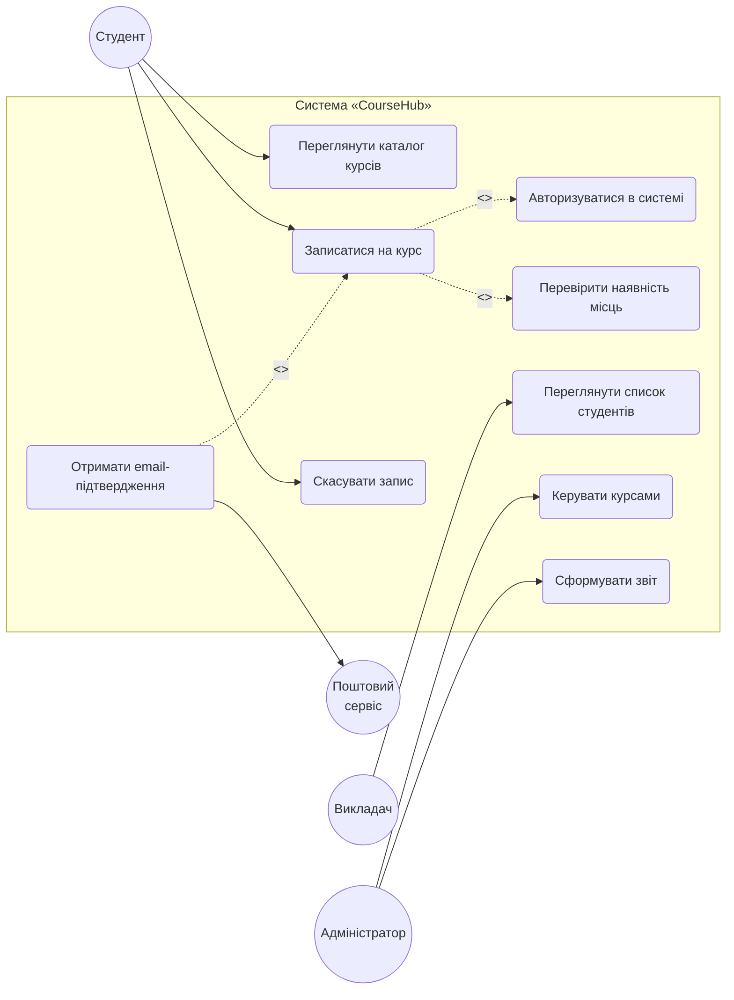

# Практична робота 9. Розроблення діаграми варіантів використання (Use Case Diagram)

**Проєкт:** Вебзастосунок «CourseHub» — система онлайн-запису на курси
**Виконав:** Осіпович Ярослав

---

## 1. Аналіз акторів та варіантів використання

**Актори (щонайменше 3):**
1. **Студент** (основна роль, шукає та записується на курси).
2. **Викладач** (переглядає списки своїх студентів).
3. **Адміністратор** (керує курсами та розкладом).
4. **Поштовий сервіс** (зовнішня система, надсилає листи).

**Варіанти використання (9 прецедентів, назви дієслівні):**
1. Переглянути каталог курсів (UC-01)
2. Записатися на курс (UC-02)
3. Скасувати запис (UC-03)
4. Авторизуватися в системі (UC-04)
5. Перевірити наявність місць (UC-05)
6. Переглянути список студентів (UC-06)
7. Керувати курсами (UC-07)
8. Сформувати звіт (UC-08)
9. Отримати email-підтвердження (UC-09)

---

## 2. Діаграма варіантів використання

*(Примітка: Студент має узагальнений зв'язок із прецедентами, оскільки для запису на курс йому обов'язково треба авторизуватися (include) та перевірити місця (include). А от отримання email-підтвердження є розширенням (extend), яке може відбуватися, а може й ні, залежно від налаштувань).*

---

## 3. Опис трьох ключових варіантів використання

### UC-02: Записатися на курс
| Поле | Опис |
| :--- | :--- |
| **Назва / ID** | Записатися на курс / UC-02 |
| **Актор** | Студент |
| **Передумови** | Студент авторизований у системі. Курс існує в каталозі. |
| **Основний сценарій** | 1. Студент обирає курс у каталозі. 2. Система перевіряє наявність вільних місць (UC-05). 3. Система створює запис у базі даних. 4. Система надсилає email-підтвердження (UC-09). |
| **Альтернативні сценарії** | 2а. Якщо вільних місць немає, система виводить повідомлення «Місць немає» і пропонує стати в чергу. 1а. Студент не авторизований — система перенаправляє на сторінку входу (UC-04). |
| **Післяумови** | Студент отримав статус «Записаний» на курс. Кількість вільних місць зменшилася на 1. |
| **Пов'язані вимоги** | FR-03, FR-05, FR-09, NFR-01 |

### UC-07: Керувати курсами
| Поле | Опис |
| :--- | :--- |
| **Назва / ID** | Керувати курсами / UC-07 |
| **Актор** | Адміністратор |
| **Передумови** | Адміністратор авторизований із правами адміністратора. |
| **Основний сценарій** | 1. Адміністратор відкриває панель керування. 2. Обирає дію: створити, редагувати або видалити курс. 3. Заповнює необхідні поля (назва, викладач, розклад). 4. Система зберігає зміни. |
| **Альтернативні сценарії** | 3а. Поля заповнені некоректно — система підсвічує помилки і просить виправити. 2а. Адміністратор намагається видалити курс, на який є записи — система блокує видалення. |
| **Післяумови** | Інформація про курс оновлена в базі даних і відображається в каталозі. |
| **Пов'язані вимоги** | FR-07, FR-08, NFR-03 |

### UC-06: Переглянути список студентів
| Поле | Опис |
| :--- | :--- |
| **Назва / ID** | Переглянути список студентів / UC-06 |
| **Актор** | Викладач |
| **Передумови** | Викладач авторизований. Викладач має хоча б один активний курс. |
| **Основний сценарій** | 1. Викладач заходить у розділ «Мої курси». 2. Обирає конкретний курс. 3. Система відображає список студентів, записаних на курс. |
| **Альтернативні сценарії** | 2а. На курс ще ніхто не записався — система показує повідомлення «Список порожній». |
| **Післяумови** | Викладач отримав інформацію про студентів (ПІБ, email). |
| **Пов'язані вимоги** | FR-06 |

---

## 4. Оновлення матриці трасування (з ПР5)

| Вимога (FR/NFR) | Користувацька історія | Use Case | Діаграма / Клас | Тест |
| :--- | :--- | :--- | :--- | :--- |
| **FR-01** | Як студент, я хочу бачити список курсів. | UC-01 | *[порожньо]* | Список курсів відображається на головній. |
| **FR-03** | Як студент, я хочу записатися на курс. | UC-02 | *[порожньо]* | Статус змінюється на «Ви записані». |
| **FR-06** | Як викладач, я хочу бачити своїх студентів. | UC-06 | *[порожньо]* | Відображається таблиця зі студентами. |
| **FR-07** | Як адміністратор, я хочу керувати курсами. | UC-07 | *[порожньо]* | Курс створюється/редагується/видаляється. |

---

## 5. Чек-лист перевірки діаграми

| Критерій | Статус | Примітка |
| :--- | :--- | :--- |
| Актор — це роль, а не конкретна особа | ✅ | Використано «Студент», «Викладач», «Адміністратор». |
| Назви прецедентів — дієслівні | ✅ | «Записатися», «Керувати», «Переглянути». |
| Є межа системи (System Boundary) | ✅ | Прямокутник навколо прецедентів. |
| Використано `include` | ✅ | Зв'язок між «Записатися» та «Перевірити наявність». |
| Використано `extend` | ✅ | Зв'язок між «Отримати email» та «Записатися». |
| Наявність текстових сценаріїв | ✅ | Описано 3 прецеденти. |
| Відсутність зайвих зв'язків | ✅ | Діаграма не перевантажена. |

---

## 6. Індивідуальне завдання: Розширені альтернативні сценарії

**Обраний варіант використання:** UC-02 «Записатися на курс».

**Альтернативні сценарії (винятки):**
1. **Недійсні дані (Invalid Data):** Студент намагається записатися на курс, але його профіль не містить обов'язкового номера телефону.
   * *Реакція системи:* Система блокує запис, підсвічує поле «Телефон» червоним кольором і показує повідомлення: «Будь ласка, вкажіть номер телефону в профілі».
2. **Відсутність доступу (Access Denied):** Студент намагається записатися на курс, який призначений лише для іншої категорії студентів (наприклад, лише для випускників), хоча він не має такого статусу.
   * *Реакція системи:* Система блокує запис, кнопка «Записатися» стає неактивною, а поруч з'являється напис: «Ви не відповідаєте вимогам курсу».
3. **Технічна помилка (Technical Error):** Під час натискання кнопки «Записатися» сервер бази даних тимчасово недоступний (випав зв'язок).
   * *Реакція системи:* Система ловить помилку (try-catch на сервері), показує користувачу повідомлення: «Виникла технічна помилка. Спробуйте пізніше» та автоматично надсилає звіт про помилку адміністратору системи.

---

## 7. Відповіді на контрольні запитання

1. **Що таке актор? Чим він відрізняється від користувача?**
   * Актор — це сукупність ролей, які виконує користувач під час взаємодії з системою. Це може бути людина, інша система або пристрій. Від користувача він відрізняється тим, що актор описує *функції*, а не конкретну фізичну особу. Один користувач може виконувати ролі кількох акторів (наприклад, викладач може також бути студентом на іншому курсі).
2. **Чим include відрізняється від extend?**
   * `include` (включення) означає, що базовий прецедент *обов'язково* викликає інший прецедент (наприклад, для запису на курс обов'язково треба авторизуватися). `extend` (розширення) означає, що розширюючий прецедент *може* бути викликаний за певних умов, але не є обов'язковим (наприклад, надсилання email-підтвердження є опціональним розширенням запису).
3. **З яких частин складається опис варіанта використання?**
   Назва, Актор, Передумови, Основний сценарій, Альтернативні сценарії, Післяумови, Пов'язані вимоги.
4. **Які типові помилки трапляються в Use Case-діаграмах?**
   * Використання конкретних імен (Іван) замість ролей (Студент).
   * Використання іменників замість дієслів для прецедентів («Запис», а не «Записатися»).
   * Надмірне використання `extend` та `include` (перетворення діаграми на блок-схему).
   * Відсутність межі системи.
