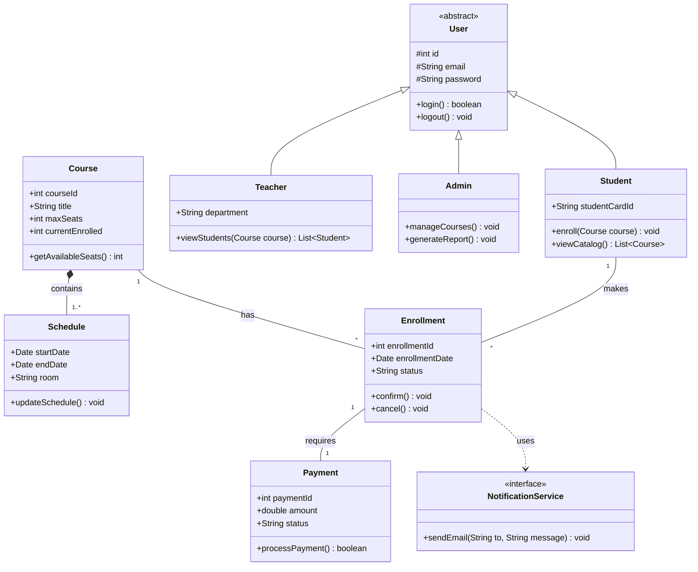

# Практична робота 10. Розроблення діаграми класів програмної системи

**Проєкт:** Вебзастосунок «CourseHub» — система онлайн-запису на курси
**Виконав:** Осіпович Ярослав

---

## 1. Визначення класів предметної області

На основі таблиці кандидатів (Практична 7) та аналізу сценаріїв (Практична 9) було визначено такі класи:
1. **User** (Абстрактний клас — базовий для всіх користувачів)
2. **Student** (Нащадок User)
3. **Teacher** (Нащадок User)
4. **Admin** (Нащадок User)
5. **Course** (Курс)
6. **Schedule** (Розклад занять)
7. **Enrollment** (Запис на курс)
8. **Payment** (Оплата за курс)
9. **NotificationService** (Інтерфейс для надсилання сповіщень)

*Відкинуті кандидати:* «Звіт» (це процес, а не об'єкт), «Швидкість» (це NFR, а не клас).

---

## 2. Діаграма класів

---

## 3. Перевірка моделі

| Критерій перевірки | Статус | Примітка |
| :--- | :--- | :--- |
| **Кожен варіант використання охоплений класами** | ✅ | Всі Use Cases з ПР9 реалізуються через методи відповідних класів (наприклад, `enroll()` для UC-02). |
| **Єдина відповідальність (SRP)** | ✅ | `Course` відповідає за дані курсу, `Schedule` — за час, `Payment` — за фінанси. |
| **Немає «класів-богів»** | ✅ | Логіку розділено між 9 класами, `User` виступає лише як абстрактний базис. |
| **Немає циклічних залежностей** | ✅ | Зв'язки йдуть від `User` до конкретних ролей, від `Enrollment` до `Payment` (без зворотних петель). |
| **Назви узгоджені з глосарієм** | ✅ | Використано англійські назви (стандарт для коду), які відповідають українським термінам із ПР6. |

---

## 4. Оновлення матриці трасування вимог (ПР5)

| Вимога (FR/NFR) | Користувацька історія | Use Case | Клас (Діаграма/Клас) | Тест |
| :--- | :--- | :--- | :--- | :--- |
| **FR-01** | Як студент, я хочу бачити список курсів. | UC-01 | `Course`, `Student` | Метод `viewCatalog()` повертає список об'єктів `Course`. |
| **FR-03** | Як студент, я хочу записатися на курс. | UC-02 | `Enrollment`, `Student` | Метод `enroll()` створює новий об'єкт `Enrollment`. |
| **FR-06** | Як викладач, я хочу бачити своїх студентів. | UC-06 | `Teacher`, `Enrollment` | Метод `viewStudents()` повертає список студентів. |
| **FR-07** | Як адміністратор, я хочу керувати курсами. | UC-07 | `Admin`, `Course` | Метод `manageCourses()` дозволяє CRUD операції. |
| **FR-09** | Блокування запису при ліміті місць. | UC-05 | `Course`, `Enrollment` | Перевірка `getAvailableSeats() > 0` перед створенням `Enrollment`. |

---

## 5. Індивідуальне завдання: Розділення класу (Принцип SRP)

**Обраний клас:** `Enrollment` (Запис на курс).
**Проблема:** У початковій моделі цей клас відповідав і за зв'язок «Студент-Курс», і за фінансовий стан (оплату). Це порушує принцип єдиної відповідальності (SRP), оскільки причини для зміни логіки реєстрації та логіки оплати різні.

**Рішення:** Клас `Enrollment` було розділено на два:
1. `Enrollment` — відповідає лише за статус реєстрації (створено, підтверджено, скасовано) та дату.
2. `Payment` — відповідає за суму, транзакції та статус оплати.

**Як змінилася діаграма:** Між `Enrollment` та `Payment` з'явився зв'язок асоціації `1` до `1` (один запис вимагає однієї оплати). Це зробило систему гнучкішою: тепер ми можемо легко додати нові способи оплати, не змінюючи логіку самого запису на курс.

---

## 6. Відповіді на контрольні запитання

1. **Чим клас відрізняється від об'єкта?**
   Клас — це шаблон (креслення), який описує структуру та поведінку (атрибути й методи). Об'єкт — це конкретний екземпляр цього класу, створений у пам'яті під час виконання програми (наприклад, клас `Student` — це опис, а об'єкт `student1` — це конкретний студент Іван).
2. **Які принципи ООП ви знаєте?**
   Інкапсуляція (приховування внутрішніх даних), Успадкування (створення нових класів на базі існуючих), Поліморфізм (здатність об'єктів з однаковим інтерфейсом мати різну реалізацію) та Абстракція (виділення головного).
3. **Чим агрегація відрізняється від композиції?**
   Обидва є зв'язком «ціле — частина». Але при **композиції** частина не може існувати без цілого (якщо видалити Курс, то його Розклад зникає). При **агрегації** частина може існувати окремо (наприклад, Викладач може існувати, навіть якщо його Курс видалили).
4. **Як знайти класи за описом вимог?**
   Шляхом лексичного аналізу: виділяємо з тексту іменники (вони стають кандидатами в класи) та дієслова (вони стають методами/операціями). Потім відсіюємо синоніми, абстрактні поняття та сутності поза межами системи.
