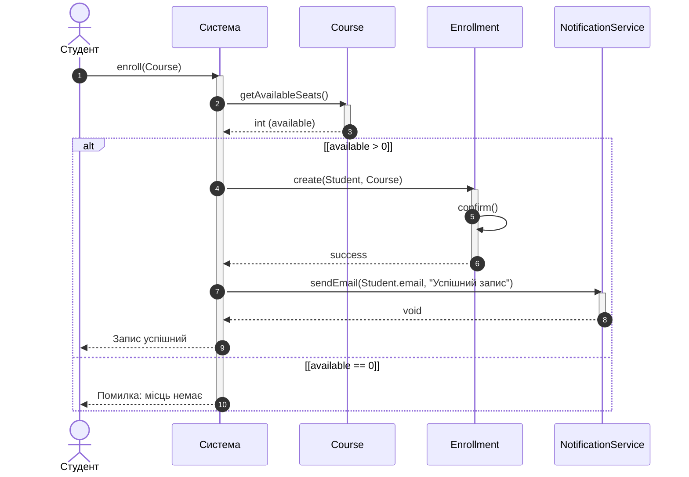
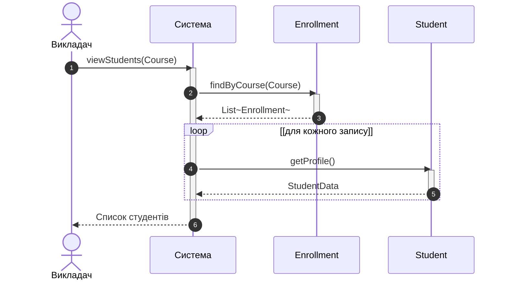
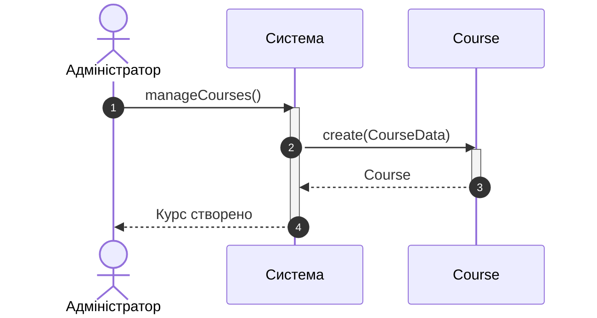
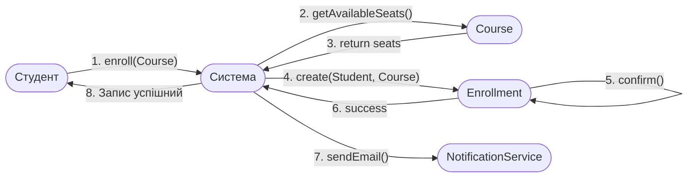
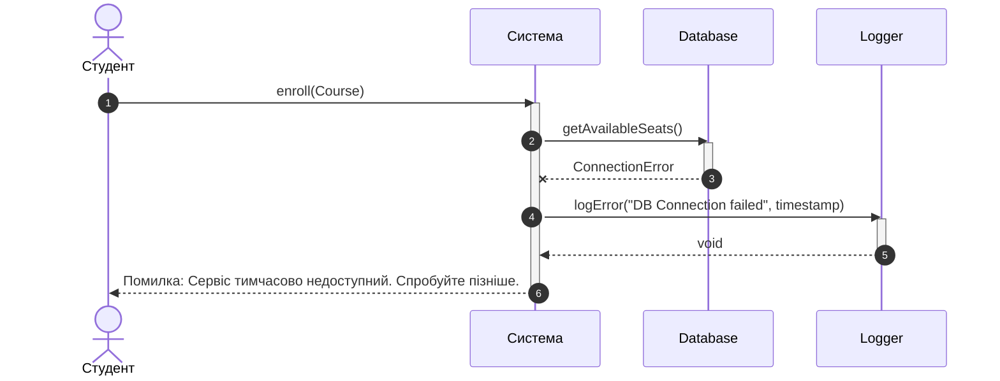

# Практична робота 11. Розроблення діаграм послідовності та комунікації

**Проєкт:** Вебзастосунок «CourseHub» — система онлайн-запису на курси
**Виконав:** студент Осіпович Ярослав

---

## 1. Діаграми послідовності для ключових варіантів використання

### 1.1. UC-02: Записатися на курс (Використано фрагмент `alt`)
*Повідомлення відповідають методам класів з ПР10.*

### 1.2. UC-06: Переглянути список студентів (Використано фрагмент `loop`)
*Додано методи `findByCourse()` та `getProfile()` у діаграму класів.*

### 1.3. UC-07: Керувати курсами

---

## 2. Діаграма комунікації (для UC-02)

*(Примітка: У діаграмі комунікації важлива послідовність, тому ми використовуємо нумерацію).

---

## 3. Перевірка узгодженості

| Критерій | Статус | Примітка |
| :--- | :--- | :--- |
| **Кожне повідомлення має адресата й операцію** | ✅ | Всі стрілки вказують на конкретні об'єкти та викликають методи (наприклад, `getAvailableSeats()`). |
| **Обсяг діаграми ≤ 8–10 учасників** | ✅ | Використано від 4 до 5 учасників на кожній діаграмі. |
| **Умови записано в квадратних дужках** | ✅ | Фрагмент `alt` містить умову `[available > 0]`. |
| **Узгодженість із діаграмою класів** | ✅ | Назви методів у повідомленнях збігаються з методами класів у ПР10. |

---

## 4. Індивідуальне завдання: Обробка помилки (Недоступна база даних)

Сценарій: під час спроби записатися на курс, сервер бази даних тимчасово недоступний.

* **Що отримує користувач:** Зрозуміле повідомлення про помилку без технічних деталей (щоб не лякати і не розкривати вразливості).
* **Що фіксується в журналі:** Час помилки, назва методу (`getAvailableSeats`), тип помилки (`ConnectionError`) для подальшого аналізу системним адміністратором.

---

## 5. Відповіді на контрольні запитання

1. **Для чого потрібні діаграми взаємодії?**
   Вони моделюють динамічну поведінку системи. Вони показують, як саме об'єкти (екземпляри класів) взаємодіють між собою в часі (діаграма послідовності) або просторі (діаграма комунікації) для виконання певного сценарію (Use Case).
2. **Чим синхронне повідомлення відрізняється від асинхронного?**
   При **синхронному** повідомленні відправник чекає, поки отримувач його обробить і поверне відповідь (на діаграмі — суцільна стрілка із зафарбованим трикутником). При **асинхронному** повідомленні відправник надсилає сигнал і продовжує роботу, не чекаючи на відповідь (на діаграмі — відкрита стрілка).
3. **Для чого використовують фрагменти alt, opt, loop?**
   * `alt` (alternative) — показує розгалуження типу "if-else" (наприклад, "є місця" / "немає місць").
   * `opt` (optional) — показує необов'язкову дію (типу "if без else").
   * `loop` — показує цикл (повторення однієї й тієї ж дії, наприклад, перебір студентів у списку).
4. **Як узгодити діаграму послідовності з діаграмою класів?**
   Назви повідомлень (стрілок) на діаграмі послідовності повинні точно збігатися з назвами операцій (методів), які вказані в класах на діаграмі класів. А учасники на діаграмі послідовності мають бути екземплярами цих класів.
