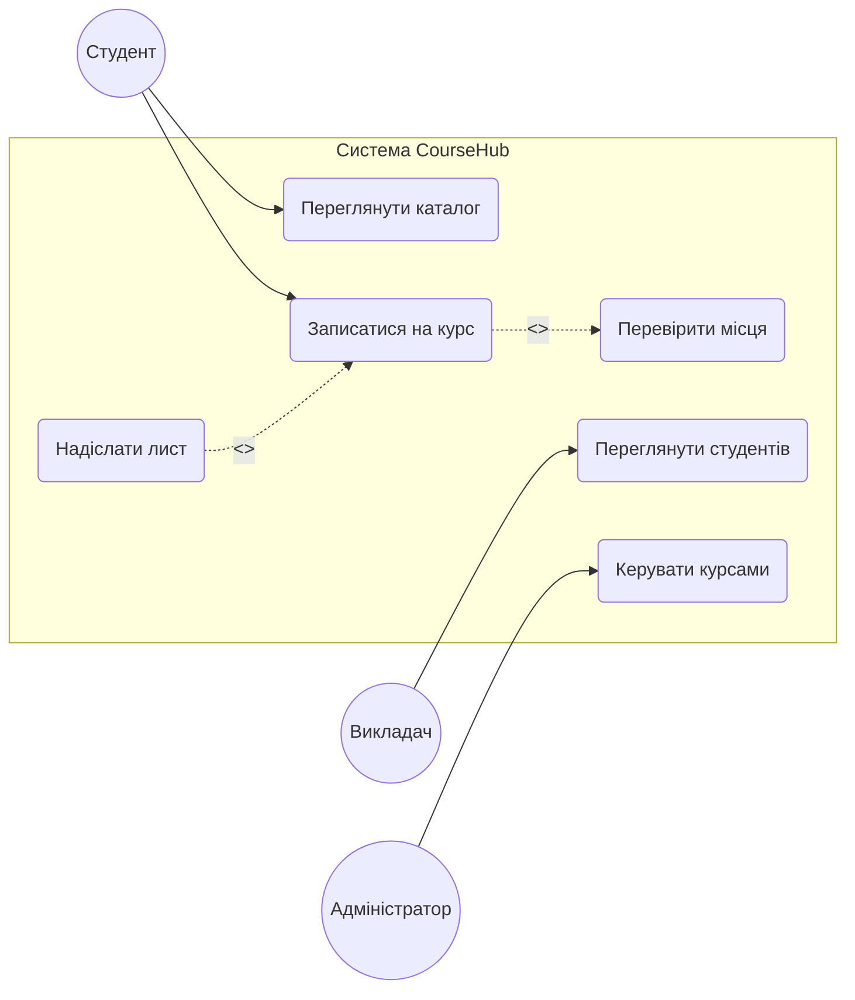
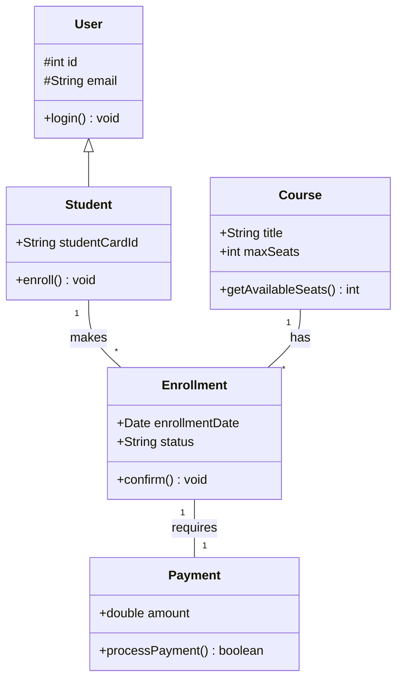
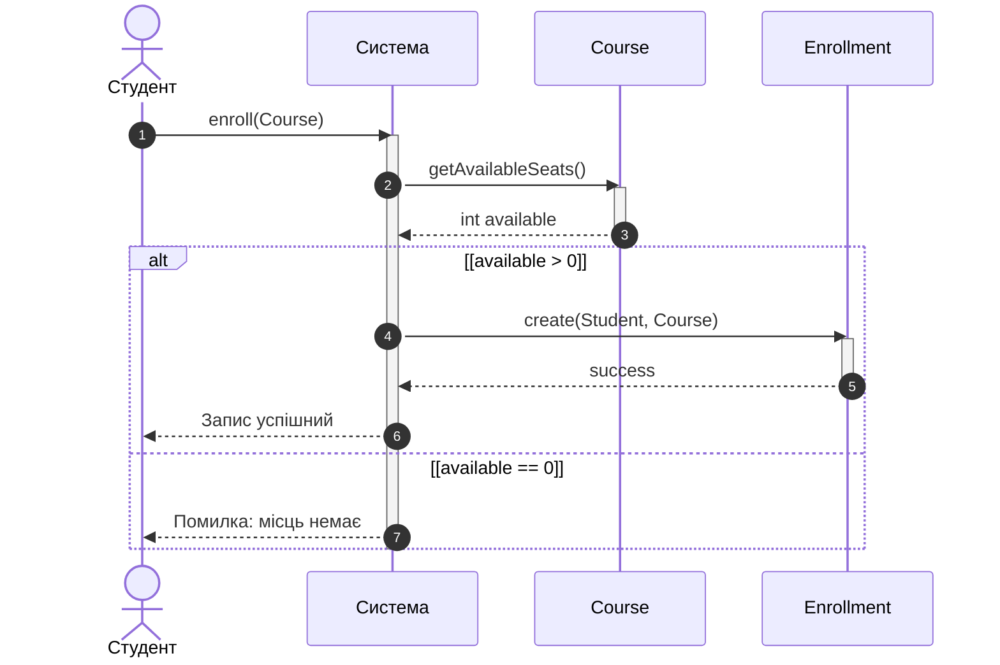

# Модульний контроль 2

**Проєкт:** Вебзастосунок «CourseHub» — система онлайн-запису на курси
**Виконав:** Осіпович Ярослав
**Варіант:** 1

---

## Частина А. Тест

1. **б)** уніфікована мова моделювання.
2. **б)** послідовності.
3. **б)** роль користувача або зовнішня система.
4. **б)** обов’язкове використання іншого варіанта.
5. **б)** private.
6. **а)** частина не існує без цілого.
7. **б)** альтернативу (if–else).
8. **б)** розміщення артефактів на вузлах.        
9. **б)** бізнес-логіки.
10. **б)** Controller.
---

## Частина Б. Практичне завдання (на прикладі проєкту «CourseHub»)

### 1. Діаграма варіантів використання (Use Case)
*Актори: Студент, Викладач, Адміністратор. Прецеденти: Записатися на курс, Переглянути студентів, Керувати курсами, Перевірити місця (include), Надіслати лист (extend).*

### 2. Діаграма класів
*5 класів із атрибутами, операціями та кратністю.*

### 3. Діаграма послідовності з фрагментом alt
*Сценарій: Студент записується на курс (перевірка наявності місць).*

### 4. Архітектурний стиль та шаблон проєктування

*   **Архітектурний стиль:** **Клієнт-серверна (3-рівнева) архітектура з використанням патерну MVC на сервері**. 
    *   *Обґрунтування:* Це дозволяє чітко розділити інтерфейс користувача (View), бізнес-логіку (Controller) та зберігання даних (Model). Для MVP проєкту це забезпечує швидку розробку, легкість тестування та можливість незалежного оновлення клієнтської частини.
*   **Шаблон проєктування:** **Singleton (Одинак)**.
    *   *Обґрунтування:* У системі буде використовуватися підключення до бази даних. Шаблон Singleton гарантує, що буде створено лише один екземпляр підключення до БД (Database Connection), що дозволить економити ресурси сервера та уникнути конфліктів під час одночасних запитів від різних користувачів.
